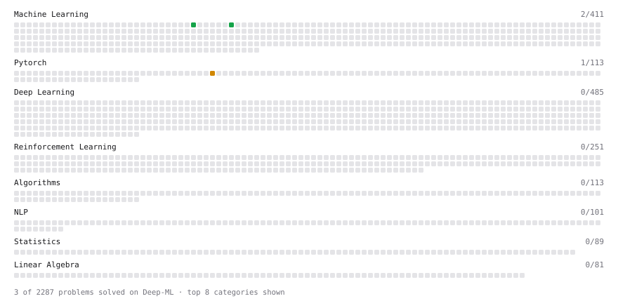

# Deep-ML

My machine learning practice from [Deep-ML](https://www.deep-ml.com). Every solution here was written by hand.

**3** solved · 2 problems · 1 labs · 0 math

[**Browse the interactive portfolio**](https://blame-13.github.io/deep-ml/) to replay this filling in over time.

## Problems

| | Difficulty | Solved | |
| --- | --- | --- | --- |
| [Binary Classification with Logistic Regression](https://www.deep-ml.com/problems/104) | easy | 2026-11-15 | [solution](problems/0104-binary-classification-with-logistic-regression) |
| [One Training Step](https://www.deep-ml.com/problems/1219) | medium | 2026-11-15 | [solution](problems/1219-one-training-step) |

## Labs

| | Difficulty | Solved | |
| --- | --- | --- | --- |
| [MLP with Dropout and BatchNorm](https://www.deep-ml.com/labs/3480fd6b-ee7a-4afd-ba4b-5c934aeab10b) | medium | 2026-11-15 | [solution](labs/3480fd6b-ee7a-4afd-ba4b-5c934aeab10b-mlp-with-dropout-and-batchnorm) |

---

_This file is regenerated by Deep-ML on every push._
